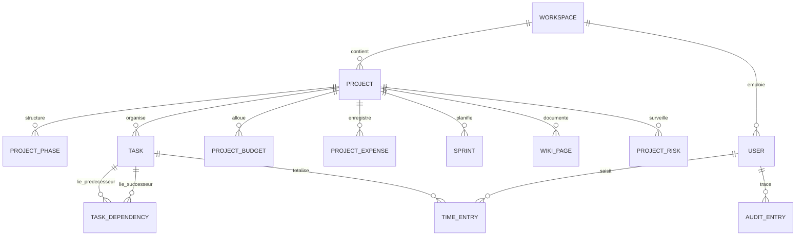
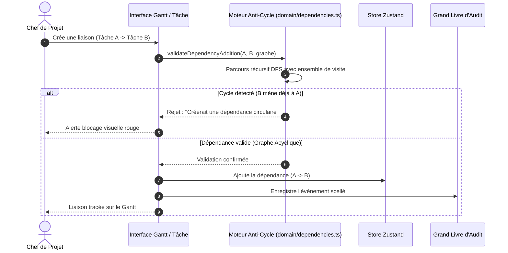
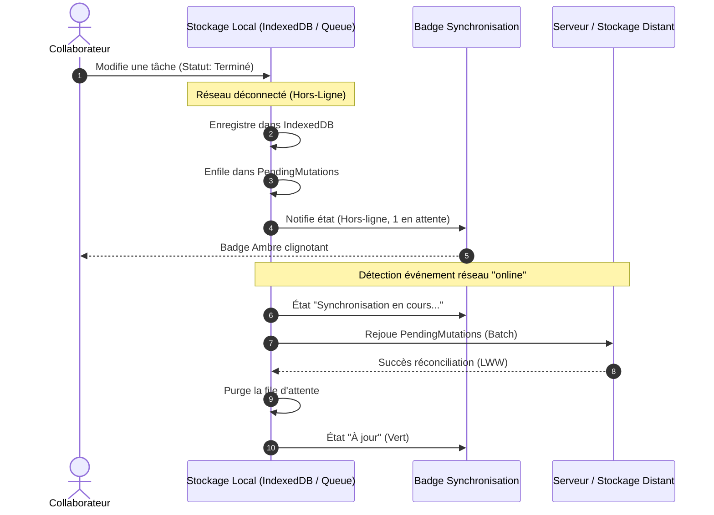

# SENTINEL GESTION — Architecture Technique & Diagrammes Système

Ce document présente l'architecture logicielle, les flux de données, les algorithmes critiques et les diagrammes fonctionnels de **SENTINEL GESTION**.

---

## 1. Vue d'Ensemble de l'Architecture en Couches

```mermaid
graph TD
  subgraph Interface Utilisateur (React 19 & Next.js 16.4)
    A1[17 Vues Opérationnelles]
    A2[Barre Latérale & Topbar Réactive]
    A3[Modales Globales & Accessibilité RGAA]
  end

  subgraph État Applicatif & Logique Métier
    B1[Store Global Zustand / React Context]
    B2[Moteur Anti-Cycle DFS & Dépendances Gantt]
    B3[Calculateur Financier & Main d'Œuvre Horaire]
    B4[Algorithme Burndown & Story Points Fibonacci]
    B5[Moteur de Surcharge Équipe 35h]
  end

  subgraph Sécurité & Cryptographie Côté Client
    C1[Web Crypto API AES-GCM 256 bits]
    C2[Grand Livre d'Audit SHA-256 Chaîné]
    C3[Matrice d'Habilitations RBAC & Sessions]
    C4[Module RGPD : Portabilité Art. 20 & Anonymisation Art. 17]
  end

  subgraph Persistance & Résilience Hors-Ligne (Offline-First)
    D1[Base Locale IndexedDB Haute Capacité Dexie]
    D2[File d'Attente de Mutations PendingMutations]
    D3[Moteur de Réconciliation Last-Write-Wins LWW]
    D4[Générateur d'Avatars Vectoriels SVG Locaux]
  end

  A1 --> B1
  A2 --> B1
  A3 --> B1

  B1 --> C1
  B1 --> C2
  B1 --> C3
  B1 --> C4

  B1 --> D1
  D1 --> D2
  D2 --> D3
  B1 --> D4
```

---

## 2. Modèle Conceptuel des Données (Entités-Relations)



---

## 3. Algorithme de Détection Anti-Cycle (Graphe Orienté DFS)

Pour garantir qu'aucune dépendance de tâche ne crée d'interblocage infini ($A \rightarrow B \rightarrow A$ ou $A \rightarrow B \rightarrow C \rightarrow A$), le moteur exécute un parcours en profondeur (*Depth-First Search*) avant toute validation :



---

## 4. Grand Livre d'Audit Infalsifiable (Chaîne SHA-256)

Chaque événement $E_i$ scelle cryptographiquement les données de l'action en cours avec l'empreinte du bloc précédent :

```mermaid
graph LR
    subgraph Bloc Genesis (0)
        G0[Hash Precedent : 0000...0000]
        G1[Evenement : Initialisation Espace]
        G2[Hash H0 : SHA-256]
    end

    subgraph Bloc 1 (Projet Cree)
        B10[Hash Precedent : H0]
        B11[Evenement : Creation Projet]
        B12[Hash H1 : SHA-256]
    end

    subgraph Bloc 2 (Budget Modifie)
        B20[Hash Precedent : H1]
        B21[Evenement : Budget 45000 EUR]
        B22[Hash H2 : SHA-256]
    end

    G2 --> B10
    B12 --> B20
```

Si le montant du budget du Bloc 2 est modifié dans la base locale sans recalculer la chaîne, la vérification mathématique `verifyAuditTrailIntegrity` échoue immédiatement et cible le bloc compromis.

---

## 5. Cycle de Vie de la Synchronisation Hors-Ligne


